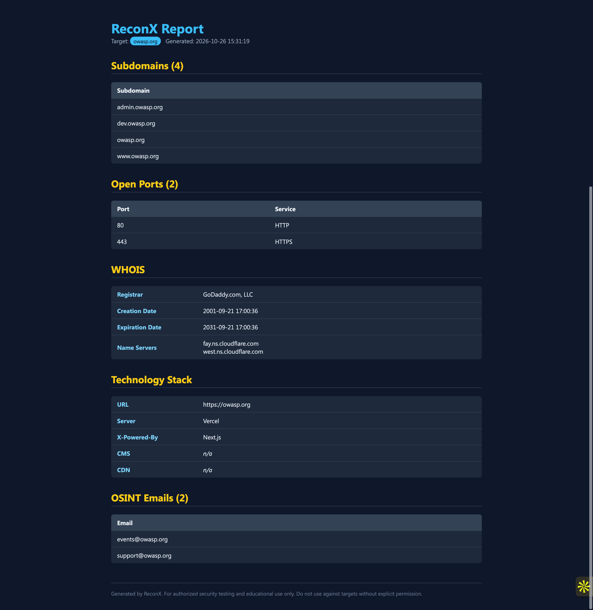

# ReconX

> Automated Recon Framework for Pentesters

ReconX automates the first phase of penetration testing: **Reconnaissance and OSINT**.
Give it a single domain and it enumerates subdomains, scans common ports, fingerprints
the technology stack, harvests OSINT emails, and generates clean JSON and HTML reports.

Works with **no paid API keys**.

---

## Features

| Module | File | What it does |
|---|---|---|
| Subdomain Enumeration | `modules/subdomain_enum.py` | crt.sh Certificate Transparency + DNS brute-force wordlist |
| WHOIS Lookup | `modules/whois_lookup.py` | Registrar, creation/expiry dates, name servers |
| Port Scanning | `modules/port_scan.py` | Multi-threaded TCP connect scan of top 10 ports |
| Tech Detection | `modules/tech_detect.py` | Server, X-Powered-By, CMS, CDN fingerprinting |
| Email OSINT | `modules/osint_email.py` | Regex email harvesting from homepage + contact pages |

---

## Architecture

```
Domain
  |
  v
[ Subdomains ] --> [ Ports ] --> [ Tech Stack ] --> [ OSINT Emails ]
                                                          |
                                                          v
                                               [ JSON + HTML Report ]
```

---

## Installation

```bash
git clone https://github.com/yusufdhansay/ReconX.git
cd ReconX
pip install -r requirements.txt
```

Requirements: Python 3.8+ and the packages in `requirements.txt`
(`requests`, `beautifulsoup4`, `python-whois`, `dnspython`).

---

## Usage

```bash
# Basic scan
python reconx.py --domain example.com

# Custom output directory
python reconx.py --domain tesla.com --output reports/
```

Flags:

| Flag | Description | Default |
|---|---|---|
| `-d`, `--domain` | Target domain (required) | - |
| `-o`, `--output` | Report output directory | `reports/` |

Sample run output:

```
[*] Finding subdomains (crt.sh + brute-force)...
[+] Found 12 subdomains
[*] Running WHOIS lookup...
[+] Registrar: MarkMonitor Inc.
[*] Scanning top 10 ports...
[+] Found 3 open ports
[*] Detecting technology stack...
[+] Tech: cloudflare, Cloudflare
[*] Harvesting emails (OSINT)...
[+] Found 2 email(s)
[*] Generating reports...
[+] HTML report: reports/report_example.com_20261026_152536.html
```

---

## Sample Report

Reports are written to the output folder as:

- `report_<domain>_<timestamp>.json` structured data
- `report_<domain>_<timestamp>.html` styled visual report



> _Screenshot placeholder. Open the generated HTML file in a browser to view._

---

## Project Structure

```
reconx/
  reconx.py              # main CLI entry point
  modules/
    subdomain_enum.py
    port_scan.py
    tech_detect.py
    whois_lookup.py
    osint_email.py
  utils/
    banner.py
    logger.py
    report.py
  reports/               # generated reports
  README.md
  requirements.txt
  .gitignore
```

---

## Legal Disclaimer

ReconX is intended for **educational purposes and authorized security testing only**.
Use it only on targets you own or have explicit written permission to test.
Unauthorized scanning may be illegal in your jurisdiction. The authors accept
no liability for misuse or damage caused by this tool.
